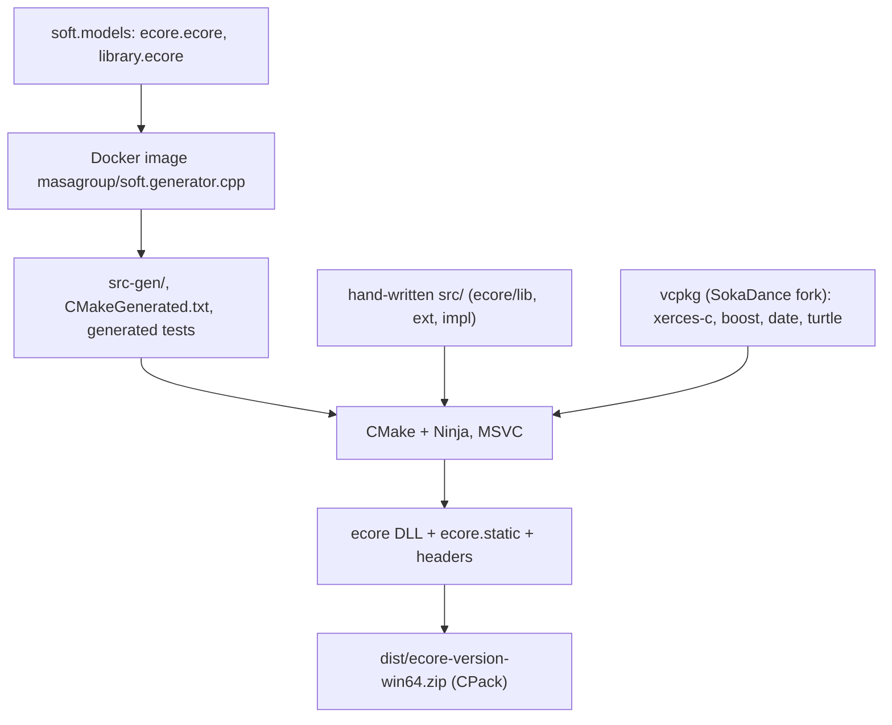
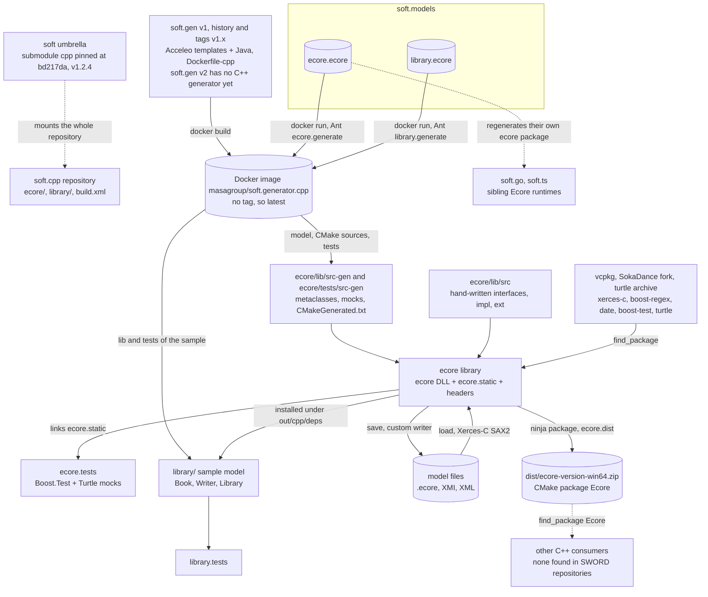
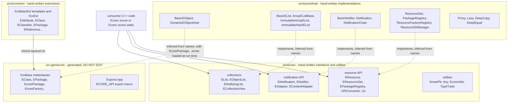
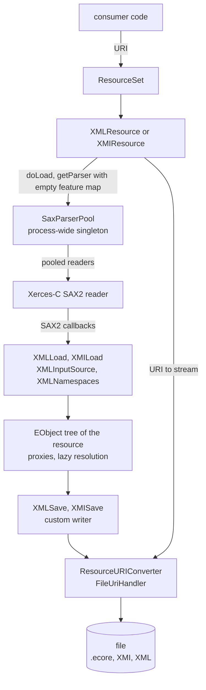
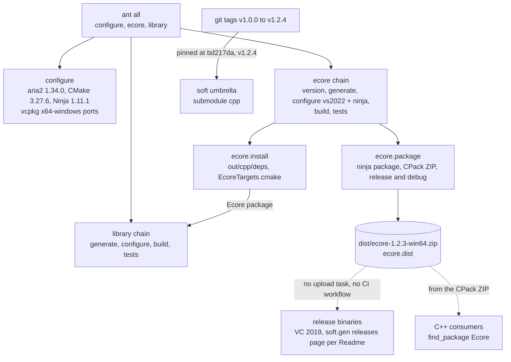

# soft.cpp: architecture

> Technical choices, diagrams and internal structure of `soft.cpp`. Back to the [README](README.md) · [Contributing](CONTRIBUTING.md) · [repository on GitHub](https://github.com/masagroup/soft.cpp)

| | |
|---|---|
| **Family** | Ecore / esync stack (SOFT family) |
| **Kind** | C++ library |
| **Languages** | C++17, CMake, Apache Ant (`build.xml`), Ecore XMI (test data) |
| **Remote / branch** | github.com/masagroup/soft.cpp, default branch master |
| **Generation** | foundation library (legacy, old gen), not a next-gen component; no SWORD consumer found |
| **Build systems** | Ant (`build.xml` at the repository root) · CMake + Ninja / Visual Studio generators · vcpkg (downloaded by Ant). No Docker Compose profile, no Go, no npm |

## Overview

The repository in its ecosystem (the text is in the [README](README.md#overview)):



## Position in the ecosystem

Foundation library of the SOFT/Ecore family, not a next-gen component. It implements the C++ runtime of the Ecore meta-model (**ecore model**: `ecore/lib`, generated from `soft.models/ecore.ecore`). It matters for the NG ecore/esync chain only indirectly: it is the C++ side of the family whose Go ([soft.go](https://github.com/masagroup/soft.go)) and TypeScript ([soft.ts](https://github.com/masagroup/soft.ts)) siblings feed the `soft.sync.*` tooling (see the ecosystem wiki pages [esync and ecore](https://github.com/masagroup/wiki/wiki/esync-ecore) and [Next-gen ecosystem](https://github.com/masagroup/wiki/wiki/ecosystem-nextgen)); UNVERIFIED for soft.cpp itself, since no esync code or reference exists in this repo. It is Windows-only, has no CI and no container build, so it would need work before use in a Linux/Docker pipeline, if that is ever required.

Unrelated: gateway, history, esync (the ecore model-sync tooling lives in the `soft.sync.*` repositories), dos, storage, authentication, node, orchestrator, commander, hub, recorder, timeline, mapserver, webclient, datacore, dispatcher, HLA.

## Repository layout

```
soft.cpp/
  build.xml, build.properties      Ant driver (root of the repo, not build/) and directory properties
  generator.properties             MPL 2.0 licence header injected into generated files
  .clang-format, .gitignore        (ignores bin, dist, out)
  LICENSE, Readme.md               MPL 2.0, the only doc (863 bytes)
  ecore/
    CMakeLists.txt                 project(ecore), enable_testing(), vcpkg toolchain if VCPKG_ROOT is set
    lib/                           the Ecore runtime library
      src/ecore/                   41 hand-written top-level headers/sources (EList, ENotification, EResource, Uri, SmartPtr, Any...)
      src/ecore/impl/              72 files: implementations (BasicEObject, DynamicEObjectImpl, XMLResource, XMIResource, SaxParserPool, ...)
      src/ecore/ext/               34 files: hand-written *BaseExt / *Ext classes layered on the generated bases
      src-gen/ecore/               generated code, git-ignored except EObject.hpp
      CMakeFiles.txt               source lists; CMakeGenerated.txt is generated (git-ignored)
      EcoreConfig.cmake.in         CMake package config template
    tests/                         Boost.Test + Turtle suite (src/*.cpp, mocks, data/*.ecore, generated MockEObject.hpp)
  library/                         sample "library" model (Book, Writer, Library) generated from soft.models/library.ecore
                                   versioned: lib/src/library/ext/WriterBaseExt.*, WriterExt.hpp and tests/
```

## Architecture

Main source areas:

| Path | Content |
|---|---|
| `ecore/lib/src/ecore/` | Interfaces: lists and collections (`EList`, `EObjectList`, `ENotifyingList`, `EUnsettableList`, `ECollectionView`), notification API (`ENotification`, `ENotificationChain`, `ENotifier`, `EAdapter`, `EContentAdapter`), resource API (`EResource`, `EResourceSet`, `EResourceFactory`, `EResourceFactoryRegistry`, `EResourceIDManager`, `EPackageRegistry`, `URIConverter`, `URIHandler`, `Uri`), utilities (`Any`, `AnyCast`, `SmartPtr`, `Stream`, `TypeTraits`, `EcoreUtils`, `EDiagnostic`, `EFeatureMap`, `ETreeIterator`) |
| `ecore/lib/src/ecore/impl/` | Implementations: `BasicEObject`, `DynamicEObjectImpl`, `BasicEList`, `ArrayEListBase`, `ImmutableArrayEList`, `ImmutableHashEList`, `BasicEObjectList`, `BasicNotifier`, `Notification`, `NotificationChain`, `PackageRegistry`, `ResourceSet`, `ResourceFactoryRegistry`, `ResourceIDManager`, `FileUriHandler`, `ResourceURIConverter`, `Proxy`, `Lazy`, `DeepCopy`, `DeepEqual`, `XMLResource`, `XMIResource`, `XMLLoad`, `XMILoad`, `XMLSave`, `XMISave`, `XMLNamespaces`, `XMLString`, `SaxParserPool`, `XMLInputSource` |
| `ecore/lib/src/ecore/ext/` | `*BaseExt.hpp/.inl` and `*Ext.hpp` for `EAttribute`, `EClass`, `EClassifier`, `EFactory`, `EModelElement`, `EOperation`, `EPackage`, `EReference`, `EStructuralFeature`, `ETypedElement`, `EcoreFactory` |
| `ecore/lib/src-gen/ecore/` | Generated Ecore metaclasses (`EClass`, `EPackage`, `EcorePackage`, `EcoreFactory`, ...) and `Exports.hpp` (DLL export macro `ECORE_API`) |

Notable patterns:
- Faithful port of EMF concepts: containment and opposite references, proxies and lazy resolution (`impl/Proxy.hpp`, `Lazy.hpp`), notification chains, content adapters, XMI and XML serialisation.
- "Generated base + hand-written extension": generated `XxxBase` classes in `src-gen` and `XxxBaseExt<...>` templates in `src/ecore/ext` (mixin style, exercised by `DiamondVsMixinsTests.cpp`). Generated files contain "Start of user code ... End of user code" protected regions (for example `src-gen/ecore/EObject.hpp`, which starts with "Code generated by soft.generator.cpp. DO NOT EDIT").
- Memory model: `std::shared_ptr` everywhere (`SmartPtr.hpp`); `EList<T>` has array, hash-based and immutable implementations.
- Dynamic models: `DynamicEObjectImpl` and `EcorePackage` allow loading `.ecore` metamodels at run time (`DynamicModelTests`).
- Serialisation: `XMLResource` / `XMIResource` load through Xerces SAX2 (`SaxParserPool` pools parsers) and save with a custom writer; `FileUriHandler` and `ResourceURIConverter` resolve a URI to a stream.
- Export model: the shared library uses `ECORE_API` with `ECORE_EXPORTS`; static consumers get `ECORE_STATIC_LIB` as a public definition of `ecore.static`.
- Consumption: `find_package(Ecore)` with targets `Ecore::ecore` and `Ecore::ecore.static` (aliases `Ecore::ecore::shared/static`) from the CPack ZIP.
- `library/` is an end-to-end check that generator output compiles and works against `ecore`.

Data flow: `soft.models/*.ecore` -> Docker `masagroup/soft.generator.cpp` -> `src-gen/`, `CMakeGenerated.txt`, generated tests and the `library/` lib -> CMake/Ninja with MSVC -> `ecore` DLL, `ecore.static`, headers -> CPack zip `ecore-<ver>-win64.zip`.

## How it works

soft.cpp is the C++ port of the Eclipse EMF Ecore runtime, the C++ member of the SOFT (Sword Object Facilities) family: it produces the `ecore` shared library (DLL), the `ecore.static` library, their headers and the CMake package `Ecore`, packaged by CPack and zipped by `ecore.dist` into `dist/ecore-<version>-win64.zip`. Nothing runs on its own: there is no service, CLI, port or network code, only the test binaries `ecore.tests` and `library.tests`; a C++ program links the library in process to build, reflect on, observe and load or save Ecore models as XMI or XML files. Part of the library is generated at build time by the Docker image `masagroup/soft.generator.cpp` (the v1 Java / Acceleo generator, built by soft.gen v1: [soft.gen](https://github.com/masagroup/soft.gen) v2 does not generate C++ yet) from `ecore.ecore` in [soft.models](https://github.com/masagroup/soft.models), so a fresh clone does not compile before the generator has run. It is an old gen foundation library, Windows / MSVC only, not a next-gen component, and no SWORD C++ repository consumes it: the next-gen model chain is built on its Go and TypeScript siblings [soft.go](https://github.com/masagroup/soft.go) and [soft.ts](https://github.com/masagroup/soft.ts).

### Components and data flow



- **Generation comes first.** `ant ecore.generate` runs `docker run --rm -v '<root>:/pwd' -v '../models:/models' -w /pwd masagroup/soft.generator.cpp -m /models/ecore.ecore -o /pwd -P /pwd/generator.properties -t generateModel -t generateLibraryCMakeSources -t generateTests -t generateTestsCMakeSources -t generateTestsCMakeDependencies`; `generator.properties` only injects the MPL 2.0 licence header. The repository versions just `src-gen/ecore/EObject.hpp` and `MockEObject.hpp`, and `ecore/lib/CMakeLists.txt` includes `CMakeGenerated.txt` as `OPTIONAL` then uses its `GENERATED_*` variables, so nothing compiles before this step. `soft.models` must sit at `../models`: true in the umbrella layout `soft/soft/cpp`, false for the standalone `soft/soft.cpp` checkout, whose sibling is named `soft.models`.
- **Build.** The generated metaclasses and the hand-written sources (41 top-level files, 72 in `impl/`, 34 in `ext/`) are compiled by CMake + Ninja with MSVC (C++17, `/MP /wd4250 /wd4251 /bigobj`) into `ecore` (SHARED, `ECORE_EXPORTS`) and `ecore.static` (public define `ECORE_STATIC_LIB`). Both link Xerces-C, Boost.Regex and HowardHinnant `date` from the SokaDance vcpkg fork, with no pinned baseline (resolved versions UNVERIFIED).
- **At run time** the library is only code inside its consumer: no environment variable is read, no port is opened, no network connection is made. The only I/O is model files (`.ecore`, XMI, XML) resolved through URI handlers.
- **Tests and sample.** `ecore.tests` links `ecore.static`, Turtle and static Boost.Test, and reads `ecore/tests/data/{bookStore.ecore,library.ecore,stream.read.txt}`. `library/` is the classic EMF "library" model generated from `library.ecore` and built against the installed ecore package (`${CMAKE_INSTALL_PREFIX}/cmake`), an end-to-end check that generator output compiles and works; `library.tests` uses `library/tests/data/library.xml` (about 1000 books).
- **Consumers.** The [soft](https://github.com/masagroup/soft) umbrella mounts the repository as submodule `cpp`, pinned at `bd217da` (v1.2.4). A workspace search found no SWORD C++ repository (`sw.sword`, `sw.cpplibs`, `directai`, `io.*`) linking `Ecore::ecore`; use of the released zip by external projects is UNVERIFIED. The next-gen chain (`sw.api.ng.go`, `sw.api.ng.ts`, esync) maps the Ecore package to soft.go and soft.ts, and no esync code or reference exists in soft.cpp, so any role of soft.cpp in esync is UNVERIFIED.

### Inside the ecore library: generated bases and hand-written layers



- **Generated base + hand-written extension.** `soft.generator.cpp` emits the `XxxBase` metaclasses into `src-gen` with "Start of user code ... End of user code" protected regions (`EObject.hpp` opens with "Code generated by soft.generator.cpp. DO NOT EDIT"); the hand-written `XxxBaseExt<...>` templates and `XxxExt` classes in `ext/` add behaviour in mixin style, exercised by `DiamondVsMixinsTests.cpp`. Regenerate instead of editing generated files.
- **Interfaces and implementations.** `src/ecore` declares the EMF API (lists, notifications and adapters, resources and registries, URI handling); `impl/` provides array, hash-based and immutable `EList` implementations, notifiers and notification chains, the resource set and registries, proxies with lazy resolution, deep copy and deep equality, plus the XML/XMI serialisation shown below.
- **Memory and threads.** `std::shared_ptr` is used everywhere (`SmartPtr.hpp`). `find_package(Threads REQUIRED)` is declared but linked to no target, and no `std::thread`, mutex or atomic is used in `ecore/lib/src`.
- **Dynamic models.** `DynamicEObjectImpl` and `EcorePackage` load `.ecore` metamodels at run time (`DynamicModelTests`).
- **Export model.** `Exports.hpp` defines `ECORE_API`; the DLL is built with `ECORE_EXPORTS`, static consumers get `ECORE_STATIC_LIB`. The output name is `ecore-vc${MSVC_TOOLSET_VERSION}-mt` (plus `-gd` in Debug). `impl/AbstractEObject.hpp` is listed nowhere and referenced nowhere: a candidate dead file.

### Inside resource loading and saving



- A resource is addressed by a URI (`Uri`); `ResourceURIConverter` and `FileUriHandler` resolve it to a stream. The handler named in the sources is the file one (`FileUriHandler`); the library has no network code.
- Loading goes through Xerces-C SAX2: `XMLResource::doLoad` (`impl/XMLResource.cpp`) takes a reader from `SaxParserPool` with an empty feature map, and the Xerces includes live in `impl/XMLLoad`, `SaxParserPool` and `XMLInputSource`. Saving uses a custom writer, not Xerces. The sources name these classes but do not describe the calls between `XMLResource`, `XMLLoad`/`XMILoad` and `XMLSave`/`XMISave` (edges inferred from class names, UNVERIFIED); likewise inferred and UNVERIFIED are the edges from `ResourceSet` to `XMLResource`/`XMIResource`, from `ResourceURIConverter` to the file, from the writer to `ResourceURIConverter` and from the EObject tree to `XMLSave`/`XMISave`, and the label "SAX2 callbacks" (the sources say only that loading goes through Xerces-C SAX2). That `XMIResource` reuses the same `doLoad` without overriding it is UNVERIFIED.
- Cross-resource references follow EMF: containment and opposite references, proxies resolved lazily (`impl/Proxy.hpp`, `Lazy.hpp`), notification chains and content adapters on changes.
- Two caveats from the scan (no audit exists): `SaxParserPool` holds an unguarded `std::list` of readers and nothing in `ecore/lib/src` synchronises, so the library is not thread-safe; and no `setFeature`, security manager or `XMLUni::fg*` setting exists, so external entity and DTD processing are not explicitly disabled and XXE-style resolution is likely possible on untrusted XML (the exact Xerces defaults of the vcpkg version are UNVERIFIED).

### From sources to artifacts



- The only build is Windows / MSVC through Ant, with `build.xml` at the repository root (not in `build/`), run after `VsDevCmd.bat -arch=amd64 -vcvars_ver=14.0 -winsdk=10.0.19041.0`; it needs JDK, Ant and Ant-contrib, Docker Desktop (only for the generator) and network access for the tool and vcpkg downloads. Whether `ant all` still works end to end today is UNVERIFIED (possible blockers: `../models` versus `soft.models`, the command-line syntax of the `latest` generator image (1.2.4 according to the soft.cpp page, which still calls `soft.gen/Dockerfile-cpp` current, while the soft.gen page says the v1 tree that built it is removed from master) versus `build.xml`, VS 2022, availability of the SokaDance archive).
- `ecore.dist` zips the CPack zips of both the debug and release build directories, so both must be built and packaged. The zip is named 1.2.3 (`ecore.version` and `project(ecore.lib VERSION 1.2.3)`) although the sources are at or after tag `v1.2.4`.
- There is no Dockerfile, no `docker-compose.yaml` and no `.github/`: no `prod`/`test`/`pack` profile, no `masagroup/cicd` pipeline, no `packages-latest` image, and no `<update>`, `<update-gh>` or `<upload>` task, so nothing reaches file1 or GitHub release assets from this repository. Where the binaries of `v1.0.0`..`v1.2.4` are published and who builds them is UNVERIFIED.
- Consumers use `find_package(Ecore)` with targets `Ecore::ecore` and `Ecore::ecore.static` (aliases `Ecore::ecore::shared/static`). A Linux build is not possible as is: includes and `CMakeFiles.txt` use `URI`/`FileURIHandler` while the files are `Uri`/`FileUriHandler` (13 `ecore/URI.*` includes, 3 `FileURIHandler.hpp` includes), and the compile flags are MSVC-only; whether a Linux build is wanted for the containerised next gen is UNVERIFIED.

## Dependencies

### Internal (MASA repositories)

| Repository | How it is pulled | What for |
|---|---|---|
| [soft.models](https://github.com/masagroup/soft.models) (`ecore.ecore`, `library.ecore`) | Ant `ecore.generate` / `library.generate`, expected at `../models` | Ecore metamodel from which the generated part of the library, the tests and the `library/` sample are produced |
| [soft.gen](https://github.com/masagroup/soft.gen) (Docker image `masagroup/soft.generator.cpp`) | `docker run ... masagroup/soft.generator.cpp` in `build.xml` (no tag, so `latest`) | C++ generator (Java/Acceleo); the current `soft.gen/Dockerfile-cpp` builds `soft.generator.cpp-1.2.4.jar` |
| `SokaDance/vcpkg` fork (branch/tag `turtle`) | `vcpkg.install` in `build.xml` | Provides the `turtle` mocking port and a vcpkg snapshot (not a MASA repository) |

No `<update>` / `<update-gh>` call, no poney macro, no `.gitmodules`, no `FROM masagroup/*` Docker line, no `go.mod`, no `package.json`.

Used by:
- [soft](https://github.com/masagroup/soft) (umbrella) mounts this repo as submodule `cpp` (`https://github.com/masagroup/soft.cpp.git`), pinned at `bd217da` (v1.2.4).
- No SWORD C++ repository (`sw.sword`, `sw.cpplibs`, `directai`, `io.*`) was found linking against `ecore`; see "Open questions".

### External

| Library | Version | Use |
|---|---|---|
| Xerces-C (`XercesC::XercesC`) | unpinned (vcpkg port `xerces-c`, x64-windows) | SAX2 XML/XMI parsing (`impl/XMLLoad`, `SaxParserPool`, `XMLInputSource`) |
| Boost.Regex | unpinned (vcpkg `boost-regex`) | regular expressions (`boost/regex.hpp`, one source) |
| HowardHinnant `date` | unpinned (vcpkg `date`) | date/time handling for EDate attributes |
| Threads | system | `find_package(Threads REQUIRED)` is declared but not linked to any target; no `std::thread`, `std::mutex` or atomic is used in `ecore/lib/src` |
| Boost.Test (`unit_test_framework`, static) | unpinned (vcpkg `boost-test`) | test framework |
| Turtle | unpinned (`turtle`, from the SokaDance vcpkg fork) | mock objects (`MOCK_METHOD`) in tests |
| CMake 3.27.6, Ninja 1.11.1, aria2 1.34.0 | pinned in `build.xml` | build tooling |
| C++ standard | C++17 (`CMAKE_CXX_STANDARD 17`) | - |

There is no pinned vcpkg baseline: versions follow the head of the `SokaDance/vcpkg` `turtle` archive.
