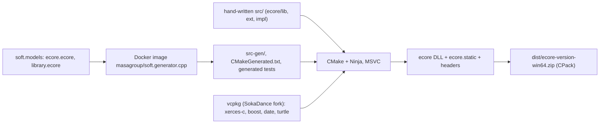

<!--
sword:
  schema: 1
  name: soft.cpp
  family: ecore-esync
  kind: cpp-lib
  generation: old-gen
  shipped: false
  languages: [C++, CMake, Ant, Ecore]
  build: [ant, cmake]
  ng: [ecore-model]
  apps: []
-->

# soft.cpp

[](https://github.com/masagroup/soft.gen/blob/master/LICENSE)


> C++ port of the Eclipse EMF Ecore runtime (reflective metamodel, notifications, resources, XMI/XML load and save), partly generated by `soft.generator.cpp` from `soft.models/ecore.ecore`; it is the C++ member of the SOFT (Sword Object Facilities) family and has no known consumer among the SWORD C++ repositories.

| | |
|---|---|
| **Family** | Ecore / esync stack (SOFT family) |
| **Kind** | C++ library |
| **Languages** | C++17, CMake, Apache Ant (`build.xml`), Ecore XMI (test data) |
| **Remote / branch** | github.com/masagroup/soft.cpp, default branch master |
| **Generation** | foundation library (legacy, old gen), not a next-gen component; no SWORD consumer found |
| **Build systems** | Ant (`build.xml` at the repository root) · CMake + Ninja / Visual Studio generators · vcpkg (downloaded by Ant). No Docker Compose profile, no Go, no npm |

## Overview

`soft.cpp` is the C++ implementation of the EMF Ecore library: `EObject`, `EClass`, `EPackage`, `EFactory`, notifications and adapters, resources and resource sets, proxies, XMI and XML serialisation. It is "partially generated and referenced by the Soft Cpp Generator" (`Readme.md`): the Ecore metaclasses are produced by `soft.generator.cpp` from `soft.models/ecore.ecore`, while collections, notifications, resources and extension classes are hand-written.

It is a pure library (shared DLL and static lib). It has no service, no CLI, no port, no network code and no environment variable read at run time. The only executables are test binaries. Consumers use it through the CMake package `Ecore` from a CPack ZIP.

Licence: Mozilla Public License 2.0 (`LICENSE`, copyright 2021 MASA Group in `build.properties`/`generator.properties`). Hand-written sources still carry an older MASA end-user licence header (copyright 2020).

Activity: almost all commits are by one developer under several identities, plus one by another contributor. The only commits after `v1.2.4` are from 2023 and touch `build.xml` (ninja 1.11.1, cmake 3.27.6 + vs2022, generator command-line syntax) plus `ecore/lib/src/ecore/ext/EClassifierBaseExt.hpp/.inl` ("Fix tests", library code); the difference between the `v1.2.4` submodule pin `bd217da` and the current head is exactly these 3 files.

Position in the SOFT family (siblings): [soft](https://github.com/masagroup/soft) (umbrella repository that mounts this repo as submodule `cpp`, pinned at `bd217da` = v1.2.4), [soft.gen](https://github.com/masagroup/soft.gen) (generators), [soft.models](https://github.com/masagroup/soft.models) (`ecore.ecore`, `library.ecore`), [soft.go](https://github.com/masagroup/soft.go), [soft.ts](https://github.com/masagroup/soft.ts), [soft.acceleo](https://github.com/masagroup/soft.acceleo), `soft.sync.*`.



## Repository layout

```
soft.cpp/
  build.xml, build.properties      Ant driver (root of the repo, not build/) and directory properties
  generator.properties             MPL 2.0 licence header injected into generated files
  .clang-format, .gitignore        (ignores bin, dist, out)
  LICENSE, Readme.md               MPL 2.0, the only doc (863 bytes)
  ecore/
    CMakeLists.txt                 project(ecore), enable_testing(), vcpkg toolchain if VCPKG_ROOT is set
    lib/                           the Ecore runtime library
      src/ecore/                   41 hand-written top-level headers/sources (EList, ENotification, EResource, Uri, SmartPtr, Any...)
      src/ecore/impl/              72 files: implementations (BasicEObject, DynamicEObjectImpl, XMLResource, XMIResource, SaxParserPool, ...)
      src/ecore/ext/               34 files: hand-written *BaseExt / *Ext classes layered on the generated bases
      src-gen/ecore/               generated code, git-ignored except EObject.hpp
      CMakeFiles.txt               source lists; CMakeGenerated.txt is generated (git-ignored)
      EcoreConfig.cmake.in         CMake package config template
    tests/                         Boost.Test + Turtle suite (src/*.cpp, mocks, data/*.ecore, generated MockEObject.hpp)
  library/                         sample "library" model (Book, Writer, Library) generated from soft.models/library.ecore
                                   versioned: lib/src/library/ext/WriterBaseExt.*, WriterExt.hpp and tests/
```

## Build

The build is Windows / MSVC only. There is no Dockerfile, no `docker-compose.yaml` and no `.github` directory.

Important: a fresh clone cannot be compiled before running the code generator. `ecore/lib/src-gen/ecore/` versions only `EObject.hpp` and `ecore/tests/src-gen/ecore/tests/` only `MockEObject.hpp`; `CMakeGenerated.txt` and all other generated headers/sources (`EClass.hpp`, `EPackage.hpp`, `EcorePackage.hpp`, `Exports.hpp`, ...) are produced by `soft.generator.cpp` (Ant targets `ecore.generate`, `library.generate`).

### Windows (Ant)

Prerequisites:
- JDK, Apache Ant and Ant-contrib on the PATH.
- Docker Desktop (used only to run the generator image `masagroup/soft.generator.cpp`).
- Visual Studio 2022 with the MSVC environment initialised (see the ecosystem wiki page "Build on Windows").
- A checkout of `soft.models` at `../models` relative to the repository (`models.dir` in `build.xml`). A standalone checkout named `soft.models` does not provide `../models`; the umbrella submodule layout (`soft/soft/cpp`) does.
- Network access: Ant downloads aria2, CMake, Ninja and vcpkg.

Run from the repository root:

```powershell
cmd /c '"C:\Program Files\Microsoft Visual Studio\2022\Professional\Common7\Tools\VsDevCmd.bat" -arch=amd64 -vcvars_ver=14.0 -winsdk=10.0.19041.0 && ant all'
```

Single steps (same MSVC environment initialised first):

```
ant configure                  # installs aria2/cmake/ninja into bin/ and vcpkg into out/vcpkg
ant ecore.generate             # regenerate src-gen (needs docker + ../models)
ant ecore.configure.ninja.release ecore.build.release ecore.tests.release
ant library                    # generate + configure + build + tests of the sample "library" model
ant ecore.package ecore.dist   # produces dist/ecore-1.2.3-win64.zip
```

`ecore.dist` zips the CPack zips of both the debug and release build directories, so both must have been built and packaged.

Ant configuration: `build.properties` (`root.dir=.`, `bin.dir=./bin`, `out.dir=./out`, `downloads.dir=./out/downloads`, `dist.dir=./dist`, `vcpkg.dir=./out/vcpkg`); `${user.home}/build.properties` is loaded first and can override. Default target of the project is `all`.

Pinned tools downloaded into `bin/` (SHA-512 checked): aria2 1.34.0 (win64), CMake 3.27.6 (windows-x86_64), Ninja 1.11.1. vcpkg comes from `https://github.com/SokaDance/vcpkg/archive/turtle.zip` into `out/vcpkg`, is bootstrapped with `bootstrap-vcpkg.bat`, then `vcpkg --triplet x64-windows install boost-test boost-regex date turtle xerces-c`.

Ant targets (none has a `description`; derived from the `depends` chain):

| Target | What it does |
|---|---|
| `checksum` | prints SHA-512 of aria2c, cmake, ninja |
| `aria2.install`, `cmake.install`, `ninja.install`, `tools.install` | download tools into `bin/` if the checksum does not match |
| `vcpkg.install` | download the fork and install the vcpkg ports above |
| `configure` | `tools.install,vcpkg.install` |
| `ecore.version` | rewrites `project(<name> VERSION x.y.z` in every `ecore/**/CMakeLists.txt` with `${ecore.version}` |
| `ecore.generate` | `docker run --rm -v '<root>:/pwd' -v '../models:/models' -w /pwd masagroup/soft.generator.cpp -m /models/ecore.ecore -o /pwd -P /pwd/generator.properties -t generateModel -t generateLibraryCMakeSources -t generateTests -t generateTestsCMakeSources -t generateTestsCMakeDependencies` |
| `ecore.configure.vs2015/2017/2019/2022` | CMake configure with that Visual Studio generator |
| `ecore.configure.ninja.release` / `.debug` / `ecore.configure.ninja` | CMake + Ninja, `RelWithDebInfo` / `Debug` / both |
| `ecore.configure` | `ecore.configure.vs2022,ecore.configure.ninja` |
| `ecore.build.debug` / `.release` / `ecore.build` | `ninja -j <NUMBER_OF_PROCESSORS>` in the Ninja build dirs |
| `ecore.tests.debug` / `.release` / `ecore.tests` | `ctest . --parallel N --output-on-failure --tests-regex .*` |
| `ecore.install` | `ninja install` in release then debug (prefix `out/cpp/deps`) |
| `ecore.package` | `ninja package` (CPack ZIP) in release then debug |
| `ecore.dist` | zips the debug + release CPack zips into `dist/ecore-${ecore.version}-win64.zip` |
| `ecore` | `ecore.version,ecore.generate,ecore.configure,ecore.build,ecore.tests,ecore.install,ecore.package,ecore.dist` |
| `library.generate` | same docker generator with `-m /models/library.ecore`, no `-t` filter |
| `library.configure.vs2019/vs2022`, `.ninja.release/.debug`, `library.configure` | CMake configure for `library/` |
| `library.build[.debug/.release]`, `library.tests[.debug/.release]` | ninja build and ctest |
| `library` | `library.generate,library.configure,library.build,library.tests` |
| `library.clean` | `git clean -xfd` inside `library/` |
| **`all`** | **`configure,ecore,library`** |
| `clean` | clears the read-only flag on `out/go/**` (leftover from another repo) then `git clean -xfd` on the whole repo |

CMake generators are available as macros (VS 2015/2017/2019/2022 and Ninja, arch `x64`) with `-DCMAKE_INSTALL_PREFIX=${out.dir}/cpp/deps` and `-DVCPKG_ROOT=${vcpkg.dir}`. Build directories: `out/cpp/<generator>/<project>/<configuration>`.

### Linux (Docker)

Not applicable: no Dockerfile and no compose profile (`prod`/`test`/`pack`) exist. `docker.exe` is used only to run the code generator. The sources are not Linux-ready (see "Known issues").

### Other

Manual CMake route without Ant, assuming vcpkg is installed at `%VCPKG_ROOT%` and the sources are already generated:

```
cmake -S ecore -B out/ecore-rel -G Ninja -DCMAKE_BUILD_TYPE=RelWithDebInfo -DVCPKG_ROOT=%VCPKG_ROOT%
cmake --build out/ecore-rel
ctest --test-dir out/ecore-rel --output-on-failure
```

CMake targets:

| Directory | Project | Targets |
|---|---|---|
| `ecore/` | `project(ecore CXX)`, CMake >= 3.12 | `add_subdirectory(lib)`, `add_subdirectory(tests)` |
| `ecore/lib` | `project(ecore.lib VERSION 1.2.3 LANGUAGES CXX)`, C++17 | `ecore` (SHARED, alias `ecore::shared`, defines `ECORE_EXPORTS`), `ecore.static` (STATIC, alias `ecore::static`, public define `ECORE_STATIC_LIB`). Output name `ecore-vc${MSVC_TOOLSET_VERSION}-mt` (+ `-gd` in Debug). Links `XercesC::XercesC Boost::regex date::date` (PUBLIC for `ecore`, PRIVATE for `ecore.static`). Install: `lib`, `bin`, `include/ecore{,/ext,/impl}`, export `EcoreTargets.cmake` (namespace `Ecore::`) and `EcoreConfig.cmake` into `cmake/`. CPack generator `ZIP`, package name `ecore` |
| `ecore/tests` | `project(ecore.tests CXX)` | executable `ecore.tests` linking `ecore.static Turtle::Turtle Boost::unit_test_framework` (static Boost), `boost_test_discover_tests` for ctest; copies `data/` into the binary dir |
| `library/` | `project(library CXX)` | requires the installed ecore under `${CMAKE_INSTALL_PREFIX}/cmake`; `library/lib` and `library/tests` have generated `CMakeLists.txt` (only `CMakeFiles.txt` lists are versioned) |

## Run

The repository produces no service and listens on no port. The only executables are test binaries; Boost.Test's own command-line flags apply, the project defines none.

| Executable | Entry | Purpose |
|---|---|---|
| `ecore.tests` | `ecore/tests/src/main.cpp` (`BOOST_TEST_MODULE ecore.test`) | Boost.Test + Turtle (mock) suite for the ecore library: Any, BasicEList, BasicEObjectList, BasicNotifier, DiamondVsMixins, DynamicEObject, DynamicModel, EContentAdapter, EcoreFactory, EcorePackage, EcoreUtils, EAttribute, EClass, ECollectionView, EFactory, EList, EObject, FileUriHandler, Lazy, Memory, Notification, NotificationChain, Proxy, ResourceIDManager, Resource, ResourceSet, SmartPtr, StringUtils, TypeTraits, Uri, XMLNamespaces, XMIResource. Data: `ecore/tests/data/{bookStore.ecore,library.ecore,stream.read.txt}` |
| `library.tests` | `library/tests/src/main.cpp` | Tests of the generated sample "library" model (ContentAdapter, DeepUtils, Serialization, MetaModel, Writer). Data: `library/tests/data/library.xml` (a serialised Library with about 1000 books) |

Run the tests through Ant (`ant ecore.tests`, `ant library.tests`) or `ctest` as shown above.

Inputs are build-time only: `build.properties`, `generator.properties`, `${user.home}/build.properties`, environment variables `VCPKG_ROOT` and `NUMBER_OF_PROCESSORS`.

Artifact of the Ant build: `dist/ecore-<ecore.version>-win64.zip` (CPack zip of debug + release: static lib, DLL, headers, CMake package files).

## Dependencies

### Internal (MASA repositories)

| Repository | How it is pulled | What for |
|---|---|---|
| [soft.models](https://github.com/masagroup/soft.models) (`ecore.ecore`, `library.ecore`) | Ant `ecore.generate` / `library.generate`, expected at `../models` | Ecore metamodel from which the generated part of the library, the tests and the `library/` sample are produced |
| [soft.gen](https://github.com/masagroup/soft.gen) (Docker image `masagroup/soft.generator.cpp`) | `docker run ... masagroup/soft.generator.cpp` in `build.xml` (no tag, so `latest`) | C++ generator (Java/Acceleo); the current `soft.gen/Dockerfile-cpp` builds `soft.generator.cpp-1.2.4.jar` |
| `SokaDance/vcpkg` fork (branch/tag `turtle`) | `vcpkg.install` in `build.xml` | Provides the `turtle` mocking port and a vcpkg snapshot (not a MASA repository) |

No `<update>` / `<update-gh>` call, no poney macro, no `.gitmodules`, no `FROM masagroup/*` Docker line, no `go.mod`, no `package.json`.

Used by:
- [soft](https://github.com/masagroup/soft) (umbrella) mounts this repo as submodule `cpp` (`https://github.com/masagroup/soft.cpp.git`), pinned at `bd217da` (v1.2.4).
- No SWORD C++ repository (`sw.sword`, `sw.cpplibs`, `directai`, `io.*`) was found linking against `ecore`; see "Open questions".

### External

| Library | Version | Use |
|---|---|---|
| Xerces-C (`XercesC::XercesC`) | unpinned (vcpkg port `xerces-c`, x64-windows) | SAX2 XML/XMI parsing (`impl/XMLLoad`, `SaxParserPool`, `XMLInputSource`) |
| Boost.Regex | unpinned (vcpkg `boost-regex`) | regular expressions (`boost/regex.hpp`, one source) |
| HowardHinnant `date` | unpinned (vcpkg `date`) | date/time handling for EDate attributes |
| Threads | system | `find_package(Threads REQUIRED)` is declared but not linked to any target; no `std::thread`, `std::mutex` or atomic is used in `ecore/lib/src` |
| Boost.Test (`unit_test_framework`, static) | unpinned (vcpkg `boost-test`) | test framework |
| Turtle | unpinned (`turtle`, from the SokaDance vcpkg fork) | mock objects (`MOCK_METHOD`) in tests |
| CMake 3.27.6, Ninja 1.11.1, aria2 1.34.0 | pinned in `build.xml` | build tooling |
| C++ standard | C++17 (`CMAKE_CXX_STANDARD 17`) | - |

There is no pinned vcpkg baseline: versions follow the head of the `SokaDance/vcpkg` `turtle` archive.

## Architecture

Main source areas:

| Path | Content |
|---|---|
| `ecore/lib/src/ecore/` | Interfaces: lists and collections (`EList`, `EObjectList`, `ENotifyingList`, `EUnsettableList`, `ECollectionView`), notification API (`ENotification`, `ENotificationChain`, `ENotifier`, `EAdapter`, `EContentAdapter`), resource API (`EResource`, `EResourceSet`, `EResourceFactory`, `EResourceFactoryRegistry`, `EResourceIDManager`, `EPackageRegistry`, `URIConverter`, `URIHandler`, `Uri`), utilities (`Any`, `AnyCast`, `SmartPtr`, `Stream`, `TypeTraits`, `EcoreUtils`, `EDiagnostic`, `EFeatureMap`, `ETreeIterator`) |
| `ecore/lib/src/ecore/impl/` | Implementations: `BasicEObject`, `DynamicEObjectImpl`, `BasicEList`, `ArrayEListBase`, `ImmutableArrayEList`, `ImmutableHashEList`, `BasicEObjectList`, `BasicNotifier`, `Notification`, `NotificationChain`, `PackageRegistry`, `ResourceSet`, `ResourceFactoryRegistry`, `ResourceIDManager`, `FileUriHandler`, `ResourceURIConverter`, `Proxy`, `Lazy`, `DeepCopy`, `DeepEqual`, `XMLResource`, `XMIResource`, `XMLLoad`, `XMILoad`, `XMLSave`, `XMISave`, `XMLNamespaces`, `XMLString`, `SaxParserPool`, `XMLInputSource` |
| `ecore/lib/src/ecore/ext/` | `*BaseExt.hpp/.inl` and `*Ext.hpp` for `EAttribute`, `EClass`, `EClassifier`, `EFactory`, `EModelElement`, `EOperation`, `EPackage`, `EReference`, `EStructuralFeature`, `ETypedElement`, `EcoreFactory` |
| `ecore/lib/src-gen/ecore/` | Generated Ecore metaclasses (`EClass`, `EPackage`, `EcorePackage`, `EcoreFactory`, ...) and `Exports.hpp` (DLL export macro `ECORE_API`) |

Notable patterns:
- Faithful port of EMF concepts: containment and opposite references, proxies and lazy resolution (`impl/Proxy.hpp`, `Lazy.hpp`), notification chains, content adapters, XMI and XML serialisation.
- "Generated base + hand-written extension": generated `XxxBase` classes in `src-gen` and `XxxBaseExt<...>` templates in `src/ecore/ext` (mixin style, exercised by `DiamondVsMixinsTests.cpp`). Generated files contain "Start of user code ... End of user code" protected regions (for example `src-gen/ecore/EObject.hpp`, which starts with "Code generated by soft.generator.cpp. DO NOT EDIT").
- Memory model: `std::shared_ptr` everywhere (`SmartPtr.hpp`); `EList<T>` has array, hash-based and immutable implementations.
- Dynamic models: `DynamicEObjectImpl` and `EcorePackage` allow loading `.ecore` metamodels at run time (`DynamicModelTests`).
- Serialisation: `XMLResource` / `XMIResource` load through Xerces SAX2 (`SaxParserPool` pools parsers) and save with a custom writer; `FileUriHandler` and `ResourceURIConverter` resolve a URI to a stream.
- Export model: the shared library uses `ECORE_API` with `ECORE_EXPORTS`; static consumers get `ECORE_STATIC_LIB` as a public definition of `ecore.static`.
- Consumption: `find_package(Ecore)` with targets `Ecore::ecore` and `Ecore::ecore.static` (aliases `Ecore::ecore::shared/static`) from the CPack ZIP.
- `library/` is an end-to-end check that generator output compiles and works against `ecore`.

Data flow: `soft.models/*.ecore` -> Docker `masagroup/soft.generator.cpp` -> `src-gen/`, `CMakeGenerated.txt`, generated tests and the `library/` lib -> CMake/Ninja with MSVC -> `ecore` DLL, `ecore.static`, headers -> CPack zip `ecore-<ver>-win64.zip`.

## CI/CD

| Item | State |
|---|---|
| Workflow files | none: there is no `.github/` directory and no `uses: masagroup/cicd/...` reference |
| Docker image | none (no Dockerfile, no `packages-latest` image) |
| Artifacts | only the local `dist/ecore-<ecore.version>-win64.zip` from `ant ecore.dist` |
| Publication | `build.xml` has no `<update>`, `<update-gh>` or `<upload>` task, so there is no upload to `file1` or to GitHub release assets from this repo |

Tags `v1.0.0` to `v1.2.4` exist (`v1.0.0`..`v1.2.1` annotated; `v1.2.2`..`v1.2.4` lightweight). The `Readme.md` says binaries (VC 2019) are on the releases page of `soft.gen`. See [cicd](https://github.com/masagroup/cicd) and the ecosystem wiki page "CI/CD pipelines" for the shared pipelines this repo does not use.

## Next-gen relevance

Foundation library of the SOFT/Ecore family, not a next-gen component. It implements the C++ runtime of the Ecore meta-model (**ecore model**: `ecore/lib`, generated from `soft.models/ecore.ecore`). It matters for the NG ecore/esync chain only indirectly: it is the C++ side of the family whose Go ([soft.go](https://github.com/masagroup/soft.go)) and TypeScript ([soft.ts](https://github.com/masagroup/soft.ts)) siblings feed the `soft.sync.*` tooling (see the ecosystem wiki pages "esync and ecore" and "Next-gen ecosystem"); UNVERIFIED for soft.cpp itself, since no esync code or reference exists in this repo. It is Windows-only, has no CI and no container build, so it would need work before use in a Linux/Docker pipeline, if that is ever required.

Unrelated: gateway, history, esync (the ecore model-sync tooling lives in the `soft.sync.*` repositories), dos, storage, authentication, node, orchestrator, commander, hub, recorder, timeline, mapserver, webclient, datacore, dispatcher, HLA.

## Known issues

No audit document exists. Defects and outdated documentation found by the scan:

- Fresh clone does not build: the generator step (`ant ecore.generate`) is mandatory and needs Docker, the generator image and `../models`.
- `Readme.md` is outdated: it states "VC 2019" only, a releases link pointing at `soft.gen`, and "Run in VC command line: `ant`" without mentioning Docker, `../models`, network downloads or VS 2022 (`ecore.configure` depends on `ecore.configure.vs2022`).
- Version drift: `ecore.version` (`build.xml`) and `project(ecore.lib VERSION 1.2.3)` are `1.2.3` while the latest tag is `v1.2.4`, so a dist zip named 1.2.3 is produced from sources at or after the `v1.2.4` tag.
- `build.xml` `clean` references `out/go`, a leftover from the Go sibling.
- Linux portability: files are `Uri.hpp|.cpp|.inl`, `impl/FileUriHandler.*`, `UriTests.cpp`, `FileUriHandlerTests.cpp`, but `#include "ecore/URI.hpp"` is used 12 times (13 `ecore/URI.*` includes across 13 files), `#include "ecore/impl/FileURIHandler.hpp"` 3 times, and `ecore/lib/CMakeFiles.txt` lists `URI.*`, `FileURIHandler.*`, `URITests.cpp`, `FileURIHandlerTests.cpp`. This only builds on case-insensitive file systems. Compile options `/MP /wd4250 /wd4251 /bigobj` and `MSVC_TOOLSET_VERSION` in the library name are MSVC-only.
- `ecore/lib/src/ecore/impl/AbstractEObject.hpp` is not in `CMakeFiles.txt` and referenced nowhere under `ecore/` or `library/`: candidate dead file.
- Thread safety: `SaxParserPool` is a process-wide singleton holding an unguarded `std::list` of readers and no synchronisation primitive is used in `ecore/lib/src`, so it is not thread-safe.
- Security: the library has no network code, authentication or secret handling. Its attack surface is XML/XMI parsing through Xerces-C on untrusted input. `XMLResource::doLoad` (`impl/XMLResource.cpp`) calls `pool.getParser()` with an empty feature map and no `setFeature`, security manager or `XMLUni::fg*` usage exists in `ecore/lib/src`, so external entity / DTD processing is not explicitly disabled and Xerces defaults apply (XXE-style resolution is likely possible on untrusted XML).
- Other internal notes (the `soft.models` scan) place the soft.cpp Ant file in `soft.cpp/build/`; this is wrong, `build.xml` is at the repository root.

## Open questions

- UNVERIFIED: which MASA C++ repositories or external projects consume `ecore` / `Ecore::ecore` (none found in the workspace besides the `soft` umbrella submodule; whether external projects use the released zip is unknown).
- UNVERIFIED: where the binaries of releases `v1.0.0`..`v1.2.4` are published (GitHub releases of `masagroup/soft.cpp` vs `soft.gen`) and who builds them.
- UNVERIFIED: whether `ant all` still works end to end today (not run); possible blockers are `../models` vs the checkout name `soft.models`, the command-line syntax of `masagroup/soft.generator.cpp:latest` (1.2.4) vs `build.xml`, VS 2022 toolset requirements, and availability of the SokaDance vcpkg archive.
- UNVERIFIED: whether `models.dir` can be overridden with `-Dmodels.dir=...` (it is declared with `<local>` inside each generate target).
- UNVERIFIED: the generator version required by the checked-in hand-written files (the ext files and the `src-gen/ecore/EObject.hpp` header carry copyright 2021 and no generator version).
- UNVERIFIED: which versions the unpinned vcpkg ports (`xerces-c`, `boost-*`, `date`, `turtle`) resolve to from the SokaDance `turtle` archive.
- UNVERIFIED: Xerces defaults for external entities / DTD loading in the vcpkg version used, and whether `XMIResource` overrides `doLoad`; test with a crafted XML before the security plan.
- UNVERIFIED: whether a Linux build is wanted for the containerised next-gen ecosystem; if so, fix the `URI` / `Uri` casing and the MSVC-only flags, and create a Dockerfile and `docker-compose.yaml` with `prod`/`test`/`pack` profiles.

## Legacy notes

The previous README of the repository (`Readme.md` of `masa/master before 981e44a`), kept in full; its headings are two levels lower.

[](https://github.com/masagroup/soft.gen/blob/master/LICENSE)

### Soft Cpp #

Soft Cpp is an implementation of the EMF Ecore library in C++. This library is partially generated and referenced by the [Soft Cpp Generator](https://github.com/masagroup/soft.gen)
 
Soft Cpp is part of [Soft](https://github.com/masagroup/soft) project

### Installation #
Only binary for VC 2019 are released for the moment and are available
from the [project releases](https://github.com/masagroup/soft.gen/releases) page

### Quick Build #
Requirements:
 - [Ant](https://ant.apache.org/)
 - [Ant Contrib Taks](http://ant-contrib.sourceforge.net/)
 - [VC 2019](https://visualstudio.microsoft.com/)

Run in VC command line:
```shell
ant
```
